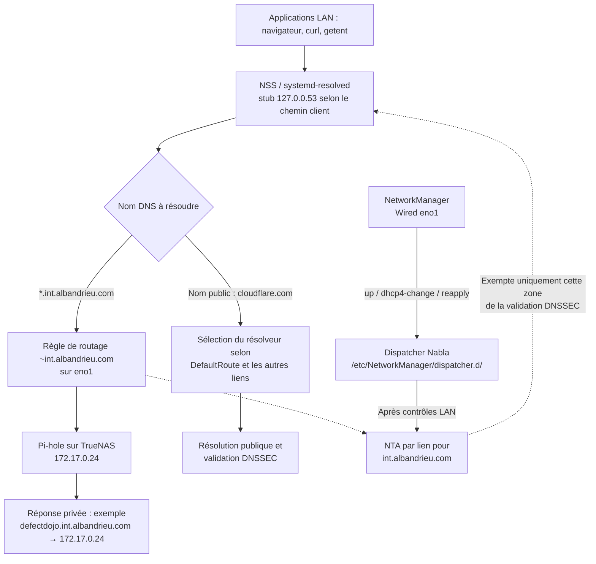

# Architecture DNS du homelab — split-DNS, DNSSEC et NetworkManager Dispatcher

**État documenté : 28 octobre 2026, mis à jour le 18 novembre 2026 (retrait de pfSense, voir la section 0).**  
**Propriétaire de la configuration :** [ansible-workstation, PR #15](https://github.com/AlbanAndrieu/ansible-workstation/pull/15).  
**Propriétaire des contrôles et des preuves :** [nabla-compose, PR #289](https://github.com/AlbanAndrieu/nabla-compose/pull/289).  
**Périmètre :** workstation Linux sur le LAN, interface `eno1`. Ne pas généraliser la configuration à d'autres hôtes ou interfaces.

## 0. État au 18 novembre 2026 : pfSense retiré

Le Netgate 1100 (pfSense) ne redémarre plus après trois tentatives. Il a été retiré, et la Freebox remise en mode routeur après une réinitialisation usine. La Freebox refuse une adresse LAN hors de `192.168.x.x` : c'est le Netgear R7000 (ancien point d'accès Wi-Fi) qui reprend `172.17.0.1` derrière elle, en double NAT. Le split-DNS continue sur la workstation, avec Pi-hole sur TrueNAS comme résolveur des noms privés.

| Élément | Avant | Depuis le 18/11 |
| --- | --- | --- |
| Passerelle et DHCP | pfSense `172.17.0.1` | Netgear R7000 `172.17.0.1`, DHCP `.100-.199` avec réservation `.57` pour la workstation, derrière la Freebox `192.168.1.254`. Administration : `https://172.17.0.1/start.htm` (la racine redirige vers `routerlogin.com` et échoue) |
| Résolveur `~int.albandrieu.com` | Unbound de pfSense `172.17.0.1` | Pi-hole de TrueNAS `172.17.0.24` |
| DNS global de `systemd-resolved` | `172.17.0.1` | Quad9 `9.9.9.9 149.112.112.112` jusqu'au 24/11, date à laquelle Quad9 cesse de servir la France ; **Cloudflare `1.1.1.1 1.0.0.1` en DoT strict depuis le 25/11** (`/etc/systemd/resolved.conf.d/99-workstation.conf`, capturé dans `files/etc`). Le lien `eno1` reste en DNS clair vers Pi-hole (`connection.dns-over-tls no`) |
| Profil NetworkManager | `Wired eno1` | `Wired eno1`, recréé en renommant le profil « Freebox » après la suppression par erreur de l'ancien. Remplacé le 25/11 par « Profile 1 » (netplan, IPv6 coupé, DHCP seul), puis renommé `Wired eno1` : le dispatcher NTA ne reconnaît que ce nom. L'adresse statique `.57` du profil n'est plus là ; seule reste la réservation DHCP |
| Adresse dans `172.17.0.0/24` | `172.17.0.57` par DHCP | `172.17.0.57` par la réservation DHCP du R7000, et la même adresse en statique dans le profil : elle garde TrueNAS et les montages NFS joignables si le bail change |

- **TrueNAS garde son IP fixe `172.17.0.24`.** Sans adresse dans `172.17.0.0/24`, la workstation ne le joint plus. Les automontages NFS `nabla:/mnt/cpool/...` de `/etc/fstab` bloquent alors tout accès sous `/media` jusqu'à leur délai de 20 s.
- **Les noms publics ne dépendent pas de TrueNAS** : le DNS global (Cloudflare depuis le 25/11, Quad9 avant) reste interrogé, et la validation DNSSEC publique reste active (`cloudflare.com` : `Data is authenticated: yes` le 18/11).
- **Un nom privé ne résout que si Pi-hole a son enregistrement local** : le 18/11, `defectdojo.int.albandrieu.com` répond `172.17.0.24`, `grafana.int.albandrieu.com` ne répond pas.
- `ipv6.ignore-auto-dns yes` écarte les DNS IPv6 de Free annoncés sur le lien : ils répondraient NXDOMAIN aux noms privés, et le dispatcher exige `172.17.0.24` comme seul DNS du lien.

Configuration appliquée (à rejouer si le profil disparaît : `nmcli connection add type ethernet ifname eno1 con-name "Wired eno1"` d'abord) :

```bash
nmcli connection modify "Wired eno1" ipv4.ignore-auto-dns yes ipv4.dns 172.17.0.24 \
  ipv4.dns-search "~int.albandrieu.com" ipv6.ignore-auto-dns yes +ipv4.addresses 172.17.0.57/24
nmcli connection up "Wired eno1"
resolvectl status eno1   # DNS 172.17.0.24, domaine ~int.albandrieu.com
resolvectl nta eno1      # int.albandrieu.com
```

Reste à faire :

1. Fait le 18/11 : le R7000 en `172.17.0.1` rend Internet à TrueNAS (Pi-hole résout de nouveau les noms publics). Détail du R7000 : runbook Freebox de nabla-compose (`docs/pfsense/runbooks/freebox-router-mode.md`).
2. Si `resolvectl status eno1` ne montre plus `172.17.0.24`, vérifier `ipv4.dns` et `ipv4.addresses` du profil : le 18/11, les deux ont été vidés une fois sans cause identifiée, puis remis avec la commande ci-dessus.
3. Compléter les enregistrements locaux `*.int.albandrieu.com` de Pi-hole.

### Retour d'un pfSense (4200 ou autre)

**Décision (19/11) : la workstation garde Pi-hole comme résolveur de `~int.albandrieu.com`, même avec un pfSense.** Les noms privés de la workstation ne dépendent plus du routeur : aucune variable, tâche ou dispatcher à changer, car les tâches imposent `172.17.0.24`. pfSense ne fait que renvoyer la zone vers Pi-hole pour les autres appareils du LAN.

Côté pfSense, tout passe par `scripts/pfsense/reconcile-split-dns.sh` de nabla-compose (contrat : `tests/test_pfsense_split_dns_reconcile.py`) :

1. Nouvelle clé d'hôte SSH : `ssh-keygen -R '[172.17.0.1]:9922'`, puis accepter la nouvelle empreinte une fois, à la main. Le script refuse une clé inconnue.
2. Si `config.xml` est restauré, le renvoi `int.albandrieu.com → 172.17.0.24` revient avec lui. Le prouver avec `bash scripts/pfsense/reconcile-split-dns.sh --check`.
3. Sur une installation vierge, activer SSH et la clé d'administration, puis lancer `--check` (avec `--port 22` tant que SSH n'est pas sur 9922). S'il signale `split_dns_override=MISSING`, lancer `--apply` : il vérifie d'abord que Pi-hole répond, garde l'historique de configuration de pfSense et ne redémarre Unbound que si quelque chose change.
4. Réception : `--check` rend `result=SPLIT_DNS_CONFIG_CONVERGED`, puis `just workstation-dnssec-dispatcher-check` depuis nabla-compose pour la workstation.

Facultatif : remettre `172.17.0.1` (relais du R7000) comme DNS global de `systemd-resolved` à la place de Cloudflare. Ce n'est pas nécessaire au split DNS, et on perdrait le DoT.

## 1. Objectif et état réel

Le but du *split-DNS* est de résoudre les noms privés en `*.int.albandrieu.com` à partir du LAN, avec un résolveur LAN (Unbound de pfSense `172.17.0.1` jusqu'au 18/11/2026, Pi-hole de TrueNAS `172.17.0.24` depuis), sans désactiver la validation DNSSEC des noms publics.

**Réception réelle :**

| Contrôle | État | Preuve |
| --- | --- | --- |
| Profil NetworkManager `Wired eno1` et DNS pfSense | **PASS** | `lan_profile=MATCH` |
| Dispatcher installé, fichier exécutable sécurisé | **PASS** | `dispatcher=ROOT_EXECUTABLE` |
| NTA DNSSEC privée sur `eno1` uniquement | **PASS** | `link_nta=EXPECTED_ONLY` |
| Résolution privée DefectDojo | **PASS** | `private_dns=PASS`, `172.17.0.24` |
| Validation DNSSEC publique sur `cloudflare.com` | **PASS** | `public_dnssec=AUTHENTICATED` |
| Restauration de NTA sur événement `reapply` | **PASS** | `nta_restored_by_event=PASS`, `diagnosis=PASS_REAPPLY_PERSISTENCE` |
| Restauration après démarrage complet du poste | **À confirmer** | Test read-only au prochain reboot planifié |

Le **dernier contrôle read-only fourni** a retourné les cinq premiers états PASS. Il ne contient **aucune nouvelle preuve de reboot**. Ne pas confondre une NTA persistée *par mécanisme* (script installé) avec une persistance *après démarrage* déjà observée.

## 2. Architecture et chemins de résolution



**Attention à la portée du routage :** `~int.albandrieu.com` est un *domaine de routage*, et non un suffixe de recherche ordinaire. Il privilégie le serveur DNS configuré sur ce lien pour les noms de cette zone. Il ne garantit **pas à lui seul** qu'un nom public utilisera un résolveur extérieur : cela dépend des autres liens et de `DNSDefaultRoute`. Le rôle Ansible configure également le résolveur LAN comme **seul DNS IPv4 de ce profil NetworkManager**. Vérifier `resolvectl status eno1` avant d'affirmer un chemin de résolution public.

| Élément | Valeur connue | Rôle |
| --- | --- | --- |
| Workstation | `172.17.0.57` | Client LAN |
| Interface | `eno1` | Lien géré par NetworkManager |
| Profil | `Wired eno1` | Profil autorisé par le dispatcher |
| DNS LAN | `172.17.0.24` | Pi-hole sur TrueNAS (pfSense `172.17.0.1` jusqu'au 18/11/2026) |
| Domaine route-only | `~int.albandrieu.com` | Oriente les requêtes privées vers le lien |
| Domaine NTA | `int.albandrieu.com` | Exempt la zone privée de validation DNSSEC sur ce lien |
| Service d'exemple | `defectdojo.int.albandrieu.com` | Résolution attendue `172.17.0.24` (TrueNAS) |
| Domaine de contrôle public | `cloudflare.com` | Doit rester **DNSSEC authentifié** |

Le domaine routé `~int.albandrieu.com` et le domaine NTA `int.albandrieu.com` sont **deux paramètres distincts**. Le premier sélectionne le résolveur ; le second contrôle la validation cryptographique.

## 3. Pourquoi une Negative Trust Anchor (NTA) ?

Sur la workstation, deux mesures répétées avaient montré :

- Requête `resolvectl query -4 defectdojo.int.albandrieu.com` avec validation normale : **TIMEOUT** (4 secondes, deux fois).
- Même nom avec `resolvectl query --validate=no` : `172.17.0.24` immédiatement.
- Les signatures `RRSIG` et le bit `AD` avaient été observés depuis pfSense pour des noms publics signés ; un domaine DNSSEC volontairement invalide recevait `SERVFAIL`.

**Interprétation opérationnelle :** la validation DNSSEC du sous-arbre privé provoquait le blocage reproduit. Une zone interne non signée sous un domaine public est une explication plausible ; les sorties disponibles **ne prouvent pas directement** l'absence de toutes les signatures de cette zone.

La solution retenue utilise :

```bash
resolvectl nta eno1
# Link 2 (eno1): int.albandrieu.com
```

Une *Negative Trust Anchor* évite la validation DNSSEC **pour cette zone privée sur ce lien**. Elle ne rend pas le réseau privé cryptographiquement authentifié et **ne remplace pas TLS**. En revanche, elle laisse la validation DNSSEC des autres noms en place. Les sorties reçues confirment `Data is authenticated: yes` pour `cloudflare.com`.

**Ne pas remplacer cette correction** par `DNSSEC=no` global, une réécriture de `/etc/resolv.conf`, une désactivation de DoT ou la suppression d'ancres DNSSEC publiques.

## 4. Dispatcher NetworkManager : fonctionnement exact

**Fichier installé sur la workstation :**

```text
/etc/NetworkManager/dispatcher.d/90-nabla-private-dnssec-nta
```

**Source versionnée :** `files/networkmanager-homelab-nta-dispatcher.sh` dans `ansible-workstation`.  
**Installation Ansible :** `tasks/network_dnssec_nta_dispatcher.yml`, permissions **root:root / 0700**.

NetworkManager lance les scripts exécutables du répertoire `dispatcher.d` lorsqu'un événement survient. Il fournit le nom de l'interface, l'action et notamment `CONNECTION_ID`. Notre script ne tourne pas en boucle et **n'est pas un nouveau résolveur DNS**.

Le script est *fail-closed* : il refuse une mutation en dehors du lien `eno1` ; pour appliquer l'ancre, il exige `Wired eno1`, DNS effectif `172.17.0.24` seul, domaine `~int.albandrieu.com`, et aucune NTA tierce. Il utilise `/usr/bin/resolvectl nta eno1`, sans modifier DNSSEC global ni redémarrer NetworkManager.

| Événement | Comportement du script |
| --- | --- |
| `up` | Ajoute la seule NTA privée si le profil, le DNS et le routage concordent |
| `dhcp4-change` | Même contrôle ; remet la NTA si elle a disparu au renouvellement |
| `reapply` | Même contrôle ; test **PASS** après `nmcli device reapply eno1` |
| `down` | Efface la NTA **uniquement** si elle est exactement `int.albandrieu.com` |
| `up/reapply` avec un autre profil, DNS ou domaine | Retire l'ancre privée **si elle est seule**, afin de ne pas l'étendre à un autre réseau |
| Une autre interface ou une action non prévue | N'effectue aucune mutation |
| NTA contenant un autre domaine | Préserve la liste ; ne l'écrase pas |

**Limite importante :** un `down` propre n'est pas garanti lors d'une coupure réseau brutale. La sûreté repose aussi sur le contrôle de profil/DNS à la prochaine activation du lien. Il n'est pas démontré que toutes les transitions réseau ou VPN possibles ont été testées réellement.

## 5. GitOps : dépôt responsable et déploiement

### `ansible-workstation` : état désiré et persistance

- `defaults/main.yml` : variables, avec `workstation_split_dns_enabled: false` et `workstation_split_dns_nta_dispatcher_enabled: false` par défaut.
- `tasks/network_split_dns.yml` : valide le lien, lit les paramètres NetworkManager, fixe si nécessaire le DNS `172.17.0.24`, ajoute le domaine `~int.albandrieu.com` **sans écraser les autres domaines**, puis réapplique le profil en cas de dérive.
- `tasks/network_dnssec_nta_dispatcher.yml` : installe/retire le dispatcher **sur opt-in seulement**.
- `playbooks/homelab-dns.yml` : point d'entrée ciblé, qui importe les seules tâches DNS ; il ne lance pas le rôle workstation complet.
- `tests/test_homelab_dns_guard_contract.py` et `tests/test_homelab_dns_nta_dispatcher.py` : garde hors ligne.
- `scripts/check_homelab_dns_gate.py` : refuse zéro test découvert et zéro tâche Ansible.

Le fichier facultatif `/etc/dnssec-trust-anchors.d/90-nabla-int-albandrieu.negative` appartient à une **alternative non choisie** : son exception s'appliquerait au domaine sur **toutes les interfaces** du poste, y compris un VPN. Conserver `workstation_split_dns_persistent_nta_enabled=false` et `workstation_split_dns_persistent_nta_remove_enabled=false`.

**Installation déjà effectuée**, avec le playbook ciblé et cinq variables d'opt-in :

```bash
ansible-playbook -i 'localhost,' playbooks/homelab-dns.yml \
  --tags dns \
  -e workstation_split_dns_enabled=true \
  -e workstation_split_dns_nta_dispatcher_enabled=true \
  -e workstation_split_dns_nta_dispatcher_remove_enabled=false \
  -e workstation_split_dns_persistent_nta_enabled=false \
  -e workstation_split_dns_persistent_nta_remove_enabled=false
```

Preuve opérateur : **ok=12, changed=1, failed=0, skipped=9**, création du dispatcher confirmée, pas d'autre modification déclarée dans la réception. La commande ci-dessus **écrit réellement sur l'hôte** ; ne pas la relancer pour vérifier l'état. Utiliser les contrôles read-only ci-dessous.

### `nabla-compose` : diagnostics, acceptation et historique

| Recette Just | Effet |
| --- | --- |
| `just workstation-dnssec-dispatcher-test` | Tests hors ligne du smoke dispatcher (**17/17 PASS**) |
| `just workstation-dnssec-dispatcher-check` | Contrôle **read-only** du profil, du fichier, de la NTA, du DNS privé et de DNSSEC public |
| `just workstation-dnssec-dispatcher-exercise` | **Mutateur** : retire brièvement la seule NTA privée, lance `nmcli device reapply eno1`, mesure sa restauration et tente un rollback borné sur échec |
| `just workstation-nss-path` | Diagnostic séparé de performance NSS, sans changer la configuration |

## 6. Validation standard et critères d'acceptation

### Contrôle quotidien ou après redémarrage — lecture seule

Depuis **`~/w/nabla-compose`** :

```bash
just workstation-dnssec-dispatcher-check

# Contrôles manuels facultatifs :
nmcli -g GENERAL.CONNECTION device show eno1
resolvectl dns eno1
resolvectl domain eno1
resolvectl nta eno1
resolvectl query -4 defectdojo.int.albandrieu.com
resolvectl query -4 cloudflare.com
getent ahostsv4 defectdojo.int.albandrieu.com
```

Une sortie de réception conforme contient :

```text
PRIVATE_NTA_DISPATCHER_ACCEPTANCE v1
  lan_profile=MATCH
  dispatcher=ROOT_EXECUTABLE
  link_nta=EXPECTED_ONLY
  private_dns=PASS
  public_dnssec=AUTHENTICATED
  mode=READ_ONLY
```

- `lan_profile=MATCH` : profil `Wired eno1`, DNS du lien `172.17.0.24`, routage `~int.albandrieu.com`.
- `dispatcher=ROOT_EXECUTABLE` : fichier régulier, root:root, exécutable par root et inaccessible au groupe/aux autres.
- `link_nta=EXPECTED_ONLY` : le lien possède uniquement `int.albandrieu.com` comme NTA.
- `private_dns=PASS` : la requête IPv4 de DefectDojo renvoie l'adresse attendue `172.17.0.24`.
- `public_dnssec=AUTHENTICATED` : `resolvectl query -4 cloudflare.com` a confirmé la validation DNSSEC de **ce domaine testé**, et non de tous les domaines publics.
- `mode=READ_ONLY` : la sonde ne modifie aucune configuration.

### Contrôle de l'événement — déjà exécuté, ne pas rejouer sans nécessité

La réception active a temporairement effacé la seule NTA privée, puis déclenché `reapply`. Elle a rendu :

```text
private_nta_temporarily_cleared=true
nm_reapply=PASS
nta_restored_by_event=PASS
private_dns=PASS
public_dnssec=AUTHENTICATED
diagnosis=PASS_REAPPLY_PERSISTENCE
```

Le retour à l'état attendu a été confirmé par deux contrôles read-only supplémentaires. Ce résultat prouve **la réapplication automatique sur cet événement**, pas encore un redémarrage complet.

### Gate encore ouverte : le prochain redémarrage planifié

Ne pas forcer un reboot pour cette seule preuve. Après un redémarrage normal, lancer `just workstation-dnssec-dispatcher-check` **sans** `--exercise` et vérifier les cinq états. Si le poste a démarré sans action de réparation manuelle, cette preuve permettra de clôturer la persistance post-reboot.

## 7. Diagnostic d'un échec

| Symptôme | Vérification non mutatrice | Interprétation / suite |
| --- | --- | --- |
| `lan_profile=UNVERIFIED` | `nmcli device status`, `resolvectl dns eno1`, `resolvectl domain eno1` | Profil, DNS ou domaine inattendu : ne pas imposer une NTA sur ce lien |
| `dispatcher=NOT_VERIFIED` | `sudo stat -c '%U:%G %a %n' /etc/NetworkManager/dispatcher.d/90-nabla-private-dnssec-nta` | Vérifier installation et droits root:root / 700 avant tout déploiement ciblé |
| `link_nta=OTHER_OR_MISSING` | `resolvectl nta eno1` | Distinguer NTA absente et NTA étrangère ; ne jamais vider aveuglément la liste |
| DNS privé échoue malgré la NTA attendue | `dig @172.17.0.1 defectdojo.int.albandrieu.com A` puis `resolvectl query -4 ...` | Isoler Unbound, transport UDP/TCP, systemd-resolved et NSS séparément |
| DNS public non authentifié | `resolvectl query -4 cloudflare.com` et `journalctl -u systemd-resolved --since '-15 min' --no-pager` | Ne pas « réparer » le public en désactivant DNSSEC ; ouvrir un diagnostic distinct |
| Le dispatcher ne réinstalle pas la NTA | `journalctl -u NetworkManager-dispatcher -u NetworkManager --since '-15 min' --no-pager` | Vérifier l'événement `reapply`, `CONNECTION_ID` et le chemin du script |
| `getent` reste lent mais `resolvectl` rapide | `just workstation-nss-path` dans Compose | Piste glibc/NSS distincte ; ne pas changer `/etc/nsswitch.conf` sans preuve |

**Signaux encore ouverts :** l'ancienne mesure `nss_default=A_CONFIRMED (4,8s)` et les messages DNSSEC publics `no-signature` dans les anciens journaux. La réussite des sondes présentes ne prouve pas leur résolution générale.

## 8. Retour arrière et règles de sécurité

**Effets d'une suppression :** sans la NTA, le DNS privé peut redevenir lent ou expirer. Prévoir une session locale et une méthode de retour arrière avant toute désinstallation ; ne pas utiliser la désactivation globale DNSSEC pour compenser.

Pour retirer **uniquement le dispatcher installé**, utiliser le playbook DNS ciblé du dépôt Ansible avec l'option de retrait explicite :

```bash
# MUTATEUR : seulement dans ansible-workstation / worktree de la PR.
ansible-playbook -i 'localhost,' playbooks/homelab-dns.yml \
  --tags dns \
  -e workstation_split_dns_enabled=true \
  -e workstation_split_dns_nta_dispatcher_enabled=false \
  -e workstation_split_dns_nta_dispatcher_remove_enabled=true \
  -e workstation_split_dns_persistent_nta_enabled=false \
  -e workstation_split_dns_persistent_nta_remove_enabled=false
```

Cette opération supprime le **fichier du dispatcher**. Elle ne garantit pas de retirer la NTA déjà présente en mémoire. Pour retirer explicitement **uniquement** la NTA attendue (si elle est toujours seule, et seulement si la perte du DNS privé est acceptable), la recette séparée Compose est `just workstation-dnssec-nta-rollback`. Elle refuse des NTA supplémentaires. Pour rétablir le comportement voulu, réinstaller le dispatcher Ansible et revérifier le lien.

**À ne pas faire :** `resolvectl revert eno1` (supprime aussi d'autres réglages DNS du lien), `DNSSEC=no` global, édition directe de `/etc/resolv.conf`, modification pfSense/Unbound sans diagnostic, `direnv allow` sur un `.envrc` non inspecté, ou lancement du rôle workstation complet pour ce correctif.

## 9. Références

**Code / documents internes :**

- [Runbook de réception Ansible](homelab-split-dns-recovery.md) — preuves datées et étapes de dépannage.
- [Diagnostic et roadmap Compose](https://github.com/AlbanAndrieu/nabla-compose/blob/fix/nexus-wan-haproxy-acl-evidence-20261027/docs/runbooks/workstation-split-dns-recovery.md).
- [Source dispatcher](../files/networkmanager-homelab-nta-dispatcher.sh), [tâches d'installation](../tasks/network_dnssec_nta_dispatcher.yml), [playbook DNS-only](../playbooks/homelab-dns.yml).

**Documentation éditeur :**

- [NetworkManager-dispatcher : événements, chemin et variables](https://networkmanager.pages.freedesktop.org/NetworkManager/NetworkManager/NetworkManager-dispatcher.html).
- [systemd resolvectl : commandes dns, domain, nta](https://www.freedesktop.org/software/systemd/man/latest/resolvectl.html).
- [systemd-resolved : routage des requêtes DNS](https://www.freedesktop.org/software/systemd/man/latest/systemd-resolved.service.html).

**Séparation des responsabilités :** la documentation architecturale et la persistance sont gérées dans **ansible-workstation** ; les diagnostics de production, les preuves runtime et les recettes Just appartiennent à **nabla-compose**.
