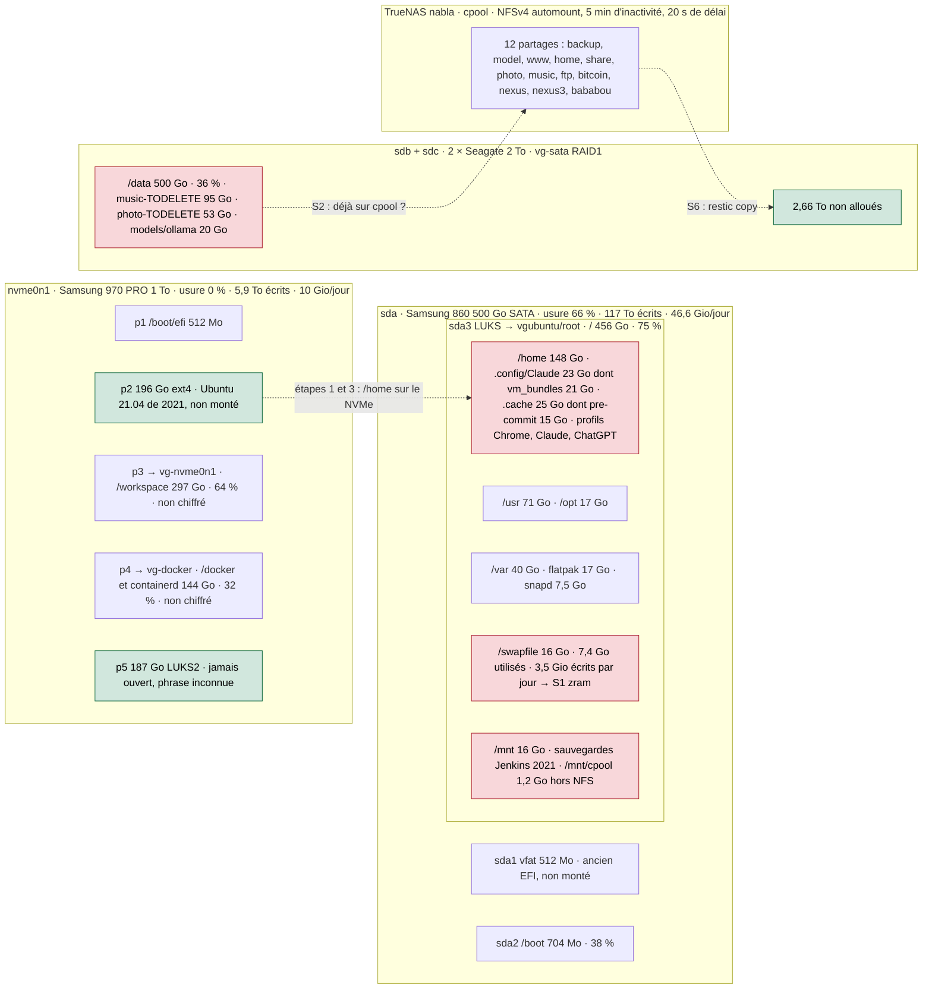

# Roadmap ansible-workstation — Ubuntu secure-by-default

**Périmètre :** seulement `ansible-workstation`. Contrat : [Option A](workstation-ownership-option-a.md). La vue homelab/YubiKey reste dans [nabla-compose](https://github.com/AlbanAndrieu/nabla-compose/blob/master/docs/roadmap-workstation-yubikey.md) ; shell utilisateur dans [dotfiles](https://github.com/AlbanAndrieu/dotfiles/blob/main/docs/roadmap-workstation.md).

**Consolidée le 10 novembre 2026** (rebase de la PR #20 sur `master` après la PR #18, puis
application de `restic-backup`, `harden-network` et `stabilize-workstation` le même jour).
Statuts : **ACCEPTED** = preuve runtime opérateur ; **APPLIQUÉ** = exécuté sur la station ;
**CODE ADDED** = code et contrats offline, runtime non vérifié ; **À faire**.

## P0 — sécurité et exposition

| Livrable | Gate de validation | Statut |
| --- | --- | --- |
| Retirer le bundle YubiKey/PAM historique du rôle global | Aucune importation `yubikey.yml`, aucune mutation PAM, aucune action matériel | **ACCEPTED** : ancien PPA + templates PAM retirés ; dépendances OS restaurées en opt-in |
| [Prérequis OS YubiKey Ubuntu autonomes](yubikey-os-prerequisites.md) | Audit sans sudo/PAM/PPA ; installation doublement autorisée | **ACCEPTED (audit seul)** : 131/131 PASS, `ok=8 changed=0`, 7/7 paquets présents ; aucun apply |
| [`playbooks/audit-workstation.yml`](../playbooks/audit-workstation.yml), distinct de `workstation.yml` | Tests Python + `mise run audit-syntax` + `changed=0` | **ACCEPTED** : 60/60, `ok=14 changed=0` ; sondes passées par un exécuteur unique fail-closed ; [preuves](audit-workstation.md) |
| [Visibilité Docker/nftables/iptables sans privilèges, lecture privilégiée optionnelle](audit-workstation-network.md) | Lecture locale, `sudo -n` fixe, aucune donnée brute | **ACCEPTED** : 68/68 et 77/77 tests ; sauts DOCKER-USER : **CODE ADDED** |
| [Sockets TCP/UDP par portée d'écoute, IPv6 zoné](audit-workstation-network.md) | Rapport agrégé sans ports ni adresses | **ACCEPTED** : 95/95 tests, `unknown=0` |
| [ufw par allowlist, NFS serveur retiré, Zabbix vers TrueNAS](workstation-network-hardening.md) | Double approbation, `ufw status verbose` | **APPLIQUÉ, rejoué le 10/11** (`changed=1`) : ufw actif au boot, INPUT/FORWARD en DROP ; règles historiques ouvertes à tous supprimées, synergy/deskflow limités au LAN, 9100 réservé à TrueNAS |
| Ports Docker publiés (DNAT avant ufw) | Mesure depuis TrueNAS de chaque port publié | **PARTIEL** : postgres/redis publiés sur `127.0.0.1` par nabla-compose ; LiteLLM 4000 et Grafana 3009 restent sur toutes les interfaces ; WAN `not_verified` |
| [Mesures TCP par allowlist privée local/LAN/WAN](workstation-network-measurement.md) | Cibles préautorisées, observateurs séparés | **LOCAL ACCEPTED** 2/2 ; LAN partiel ; WAN différé (aucun observateur externe) |
| Corriger le périmètre Ubuntu 26.04 du playbook historique | Plus de faux « unsupported » ; aucun apply global | À faire |

## P1 — configuration, sauvegarde, stabilité

| Livrable | Gate de validation | Statut |
| --- | --- | --- |
| [Stockage : sortir les écritures du SSD SATA usé, récupérer 382 Go de NVMe](#9-novembre-2026--stockage) | Archive vérifiée avant effacement, mesure avant/après | **ÉTAPE 0 APPLIQUÉE (9/11)** ; [relevé du 10/11](#10-novembre-2026--disques-et-montages-nfs) : la swap devient le premier chantier |
| [Stabilisation workstation/TrueNAS](stabilisation-workstation-truenas.md) : automontages NFS, métriques GPU, Apache durci, journald 2G | `--check`, double approbation | **APPLIQUÉ (10/11)** (`changed=2`) ; 12 automounts `media-*` actifs ; `ARGS` de node_exporter partagé avec `restic-backup.yml` sans aller-retour (contrat) |
| Partages NFS TrueNAS et hôte Zabbix en code ([`truenas-nfs-shares.yml`](../playbooks/truenas-nfs-shares.yml), [`zabbix-workstation-host.yml`](../playbooks/zabbix-workstation-host.yml), [`truenas-stabilize.yml`](../playbooks/truenas-stabilize.yml)) | Plan seul par défaut (`mise run truenas-nfs-check`, `zabbix-host-check`) | **CODE ADDED** : plans du 6/11 jamais appliqués (accès SSH TrueNAS requis) |
| [Restic](restic-evaluation.md) : sauvegarde quotidienne chiffrée vers TrueNAS | `restic check` + restauration isolée + copie indépendante | **APPLIQUÉ** : dernière réussite le 10/11 à 00:39 (dépôt 12,7 Gio) ; Prometheus TrueNAS `up=1`, `ResticBackupStale` inactive ; heartbeat OpenClaw (hôte, postgres/redis, âge du backup). Restauration isolée et copie indépendante **à faire** |
| [Capture /etc et paquets, restauration](workstation-configuration-capture.md#capture-du-contenu-31-octobre-2026) | Secrets et adresses internes expurgés (`@@SECRET@@`, `@@INTERNAL@@`), point fixe testé | **CODE ADDED** : restauration jamais appliquée |
| [Comparer état observé et `policies/home-desktop.yml`](workstation-configuration-capture.md#politique-déclarée-et-dérive) | Dérive classée, sans secrets | **CODE ADDED** |
| Nettoyer `tasks/security.yml` et unattended-upgrades | Pas de `dpkg-reconfigure` ni écrasement de conffile | **CODE ADDED** : drop-in `52unattended-upgrades-workstation`, tâches apt modernes |
| [devsec os_hardening + ssh_hardening adaptés au poste](workstation-network-hardening.md#durcissement-os--devsechardeningos_hardening) | Simulation, revue du diff, double approbation | **SIMULATION OK** (`ok=127 changed=37`) ; aucun apply |
| [Howdy et motion : une caméra chacun](howdy-cameras.md) | Audit sans sudo ; PAM jamais modifié | **CODE ADDED** : Howdy retiré du rôle global ; ACL motion restaurée ; activation PAM laissée à nabla-yubikey |
| [Nettoyage BleachBit](workstation-cleanup.md) | Caches régénérables uniquement, `check` par défaut | **CODE ADDED** : nettoyeur CleanerML validé par XSD ; journald aligné sur `SystemMaxUse=2G` |
| [Réparation de la toolchain utilisateur](user-toolchain-recovery.md) | `check` par défaut, OpenClaw épinglé | **CODE ADDED** |
| [OpenClaw : audit de la source Workstation, cible TrueNAS](openclaw-workstation-to-truenas.md) | Contrats offline, aucune mutation | **CODE ADDED** ; gateway cible géré par `nabla-openclaw` |
| [Extraire le code Workstation de nabla-compose](migration-from-nabla-compose-20261030.md) | Équivalence des sondes, secrets hors dépôt | **PREPARED / NO CUTOVER** |
| Transférer l'inventaire JSON v1 de dotfiles ici | Collecteur unique, date/source par champ | À faire |
| Profil minimal des paquets/services opt-in ; retirer les vieilles distributions | `--check` non destructif, idempotence, rollback | À faire |

## P2

| Livrable | Gate de validation | Statut |
| --- | --- | --- |
| Auditer Secure Boot / TPM / module NVIDIA | Diagnostic seulement | À faire |
| Transférer les contrats matériels vers `nabla-yubikey` | Tests hermétiques, aucun secret/PAM | **PREMIER LOT EN PR DRAFT** |
| Découpler les scripts OpenClaw/TrueNAS | API de sonde entre `nabla-openclaw` et `nabla-compose` | À faire |
| Pipeline audit → plan → apply + rétablissement éprouvé | Rollback local testé | À faire |

## Règles

- **Les faits ne sont pas des sauvegardes.** Snapshots machine hors Git ; Restic assure la
  conservation chiffrée ; garder une copie indépendante de TrueNAS.
- **Pas de CI payante ni de fusion automatique.** Tests de contrat en local (`mise run test-offline`),
  PR revues par l'opérateur.
- **Suivant :** zram à la place de la swap sur `sda` (étape S1), purge des dossiers `*-TODELETE`
  de `/data` (S2), appliquer `truenas-nfs-shares.yml`, puis l'étape 1 du stockage. Mesurer depuis
  TrueNAS les ports Docker encore publiés sur toutes les interfaces.

## 30 octobre 2026 — skills Ansible et acceptation DNS

- **Skills** : recette `mise run agent-skills-check` et alias
  `just agent-skills-check`, script de politique et tests hermétiques.
  Vérifie source déclarée, schéma et `computedHash` (format seulement),
  source canonique, liens Claude/Hermes et priorité des règles Ubuntu.
  **ACCEPTED on operator checkout (earlier HEAD): 11/11 PASS**,
  `installation=installed`, `status=pass` pour les deux skills.
  Les fichiers vendor et `skills-lock.json` sont désormais commités
  sur la PR #17 ; les six liens symboliques sont versionnés. Le
  contrôle `missing_manifest` fail-closed et la dernière extension
  de l'audit systemd **doivent encore être rejoués sur le HEAD courant**.
- **Pre-commit** : les hooks de formatage/lint n'altèrent plus
  `.agents/skills/`; les contrôles de secrets restent actifs, avec
  une exception `detect-private-key` pour le scanner de signatures
  `ansible-validator/scripts/scan_secrets.sh`. Ne pas exclure la
  totalité du répertoire des scanners.
- **DNS** : preuve opérateur du 30 octobre : `resolvectl dns eno1`
  affiche `172.17.0.1`, `resolvectl domain eno1` affiche
  `~int.albandrieu.com`; `dig @172.17.0.1` et `getent ahostsv4`
  résolvent `sample.int.albandrieu.com` vers `172.17.0.24`.
  Cela ne valide pas le DNS hors LAN ni la protection effective DNSSEC.
- **OpenClaw** : Gateway `systemd --user` actif/activé et CLI Node
  24/OpenClaw 2026.10.7 observées ; `ExecStart`, HTTP readiness et
  accès aux modèles restent **NOT VERIFIED**. L'avertissement Ansible
  Python Homebrew 3.14 est corrigé dans le code du playbook via
  `ansible_python_interpreter` mais pas encore revalidé sur la station.
- **Suite** : valider les tests des skills, inspecter les diffs tiers
  et réaliser une comparaison expurgée des `ExecStart` effectifs
  avant toute promotion de template ou bascule du Gateway.

## 9 novembre 2026 — stockage

Relevé du 8 novembre (SMART, `/sys/block/*/stat`, `pidstat -d`) :

| Disque | Contenu | État |
| --- | --- | --- |
| Samsung 860 500 Go (SATA, LUKS) | `/`, `/home` (142 Go), `/swapfile` 16 Go | **66 % d'usure** (`Wear_Leveling_Count` 34), 117 To écrits, 35 700 h ; encore 48 Gio écrits par jour, surtout les profils Chrome, Claude Desktop et ChatGPT de `/home` |
| Samsung 970 PRO 1 To (NVMe) | `/docker`, `/workspace` ; `p2` et `p5` inutilisées | 0 % d'usure, 5,9 To écrits |
| 2 × Seagate 2 To (RAID1 LVM) | `/data` 500 Go (modèles ollama 20 Go) ; 2,66 To non alloués dans `vg-sata` | `sdc` : 312 646 cycles de têtes (300 000 prévus), 32 000 h ; aucun secteur réalloué ni en attente |

Partitions NVMe inutilisées :

- `nvme0n1p2` (196 Go, ext4) : ancienne installation Ubuntu 21.04 de septembre 2021, 59 Go.
  `workspace/users/albandrieu30` (24 Go, clones de dépôts), `home/albandrieu` (22 Go, dont
  `Pictures` 9,8 Go : 60 fichiers sur 114 absents de l'actuel `~/Pictures`), `var` 7 Go, un
  `swapfile` de 2 Go. Inspectée montée en lecture seule (`ro,noload`), puis démontée.
- `nvme0n1p5` (187 Go, LUKS2) : un seul emplacement de clé, sans jeton FIDO2, absente de
  `/etc/crypttab`, jamais ouverte dans le journal. Contenu inconnu sans sa phrase de passe.

| Étape | Quoi | Gate | Statut |
| --- | --- | --- | --- |
| 0 | Supprimer les copies Docker d'avant la migration ; `apm = 254` sur les deux disques durs ; écritures en attente plafonnées à 1 Gio, vidage dès 256 Mio | [`stabilize-workstation.yml`](../playbooks/stabilize-workstation.yml), tests de contrat | **FAIT le 9/11** : `/` 84 → 74 %, `APM_level 254`, `vm.dirty_bytes` 1 Gio |
| 1 | Archiver `p2` sur TrueNAS (`tar` en lecture seule vers `/media/backup`, somme `sha256`), vérifier les 60 photos manquantes, puis l'effacer | Liste de l'archive relue et somme contrôlée avant `wipefs` | À faire |
| 2 | Ouvrir `p5` avec sa phrase de passe, inventorier, archiver ce qui compte ; sans phrase de passe, la considérer perdue | Décision de l'utilisateur, archive vérifiée | À faire (phrase de passe) |
| 3 | LUKS2 sur `p2` et `p5`, déverrouillés au boot (clé sur la racine chiffrée, ou YubiKey FIDO2), PV dans un VG `vg-nvme-crypt` : LV `home` 250 Go, LV `models` 40 Go, reste libre | `cryptsetup luksDump`, boot à froid sans intervention | À faire |
| 4 | Migrer `/home` sur le NVMe : session fermée (TTY root), `rsync -aHAXS`, `fstab`, ancienne `/home` gardée une semaine | Session graphique normale, 0 Gio/jour de profils sur `sda` (`pidstat -d`) | À faire, devant la machine |
| 5 | `OLLAMA_MODELS` sur le LV `models` (drop-in ollama) | Chargement à froid mesuré avant/après (`qwen3.5:4b`, 12 à 17 s aujourd'hui) | À faire |
| 6 | Alertes : `Wear_Leveling_Count` de `sda` sous 20, secteurs réalloués ou en attente sur `sdb`/`sdc` (métriques `smartmon_` déjà sur `:9100`) ; prévoir le remplacement de `sdc` (`lvconvert --repair`) | Alerte de test reçue | À faire |
| 7 | À terme : déplacer `/` et `/boot` du SSD 860 vers le NVMe, ou le remplacer | Après les étapes 4 et 6 | Plus tard |

Après l'étape 4, `sda` ne porte plus que le système (environ 180 Go, 40 %) : moins plein, il s'use
moins par écriture. Pas retenus : `noatime` (gain négligeable face à `relatime`), zram (aucun
swap-out mesuré, à revoir si la swap se remet à écrire).

## 10 novembre 2026 — disques et montages NFS

Relevé après 158 h de fonctionnement (`/sys/block/*/stat`, `/proc/vmstat`, `du -x`, métriques
`smartmon_` et `nvme_` de `:9100`). En rouge ce qui use ou encombre, en vert l'espace libre.

| Disque | Constat du 10/11 | Écart avec le 8/11 |
| --- | --- | --- |
| `sda` | 46,6 Gio écrits par jour ; la swap en écrit 3,5 (`pswpout`) alors que 41 Gio de RAM restent disponibles (`swappiness` 10) | Toujours 48 Gio/jour : l'étape 0 a libéré de la place, pas des écritures |
| `nvme0n1` | 10 Gio/jour ; `p3` et `p4` (`/workspace`, `/docker`) sont en LVM sans LUKS : dépôts, `.env` et volumes Docker en clair | `p2` et `p5` toujours inutilisées (382 Go) |
| `sdb` | 3 166 h seulement : disque récent, contrairement à `sdc` (32 103 h) | Le RAID1 n'est pas « deux vieux disques » |
| `sdc` | 312 856 cycles de têtes, **+1 en 24 h** : `apm = 254` a arrêté le parcage | Corrigé par l'étape 0 |
| `/data` | 148 Go sur 166 sont `music-TODELETE` et `photo-TODELETE` (2020) ; le reste, les modèles ollama | — |

Montages NFS : les 12 entrées de `fstab` sont en `x-systemd.automount` ; seuls `/media/backup`
(restic), `/media/www` (apache, via `/var/www/nabla-site-*`) et `/media/model` étaient montés.
`/media/model/ollama` (36 Go) double `/data/models/ollama` (20 Go). `showmount` ne répond plus
(NFSv4 seul) : l'état des partages côté TrueNAS reste celui du plan du 6/11, non appliqué.

| Étape | Quoi | Gain | Gate | Statut |
| --- | --- | --- | --- | --- |
| S1 | zram (`zram-generator`, zstd, 16 Gio, priorité 100) ; `/swapfile` retiré ensuite | −3,5 Gio/jour sur `sda`, 16 Go rendus à `/` | `pswpout` du `/swapfile` à 0 sur 7 jours, aucun OOM | À faire |
| S2 | Vérifier `music-TODELETE` et `photo-TODELETE` contre `cpool/media/{music,photo}` (`rsync -n --checksum`), puis les supprimer | 148 Go sur `/data` | Aucun fichier propre à la copie locale | À faire |
| S3 | Caches régénérables de `/home` : `~/.cache/pre-commit` (15 Go), `flatpak uninstall --unused` (17 Go dans `/var/lib/flatpak`) | ~20 Go sur `/` | [`workstation-cleanup.sh`](../scripts/workstation-cleanup.sh) en `check` d'abord | À faire |
| S4 | Archiver `/mnt/jenkins-15-06-2021` et `/mnt/jenkins` (15 Go) sur `/media/backup`, vider `/mnt/cpool` (1,2 Go écrits hors NFS) | 16 Go sur `/` | Somme `sha256` relue avant effacement | À faire |
| S5 | Modèles : source sur TrueNAS (`/media/model`), copie de travail sur le LV `models` NVMe (étape 5) ; `/data/models` retiré | Chargement à froid plus rapide | Mesure `qwen3.5:4b` avant/après | À faire, après l'étape 3 |
| S6 | Copie restic indépendante de TrueNAS : `restic copy` vers un LV de `vg-sata` (2,66 To libres, RAID1) | Répond à la règle « copie indépendante » | `restic check` sur les deux dépôts, restauration isolée | À faire |
| S7 | Chiffrer `/workspace` et `/docker` : à l'étape 3, déplacer leurs LV dans `vg-nvme-crypt` (`pvmove`), puis passer `p3` et `p4` en LUKS | Plus de secrets en clair sur le NVMe | `lsblk` : chaque LV sous un `crypt` | À faire, devant la machine |

Ordre proposé : S1, S2 et S3 tout de suite (sans risque, réversibles) ; puis les étapes 1 à 4 du
9/11 avec S7 ; S5 et S6 ensuite. Après S1 et l'étape 4, `sda` ne devrait plus écrire que pour le
système.
